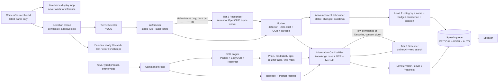

# Architecture

## Data flow

Threads: **capture**, **detect** (Tier 1 + tracking + announcements), **commands** (OCR, cards, online AI), **tier2** (one worker),
**speech**, and the **display loop** in the main thread. None of them waits on another except through "latest value" hand-offs.

## Interfaces (`smartsight/interfaces.py`) and the files that implement them
| Interface | Implementations | Selected by |
|---|---|---|
| `CameraSource` | `camera.Camera` (OpenCV), `sources.SyntheticSource` | `factory.py` |
| `Detector` | `detector.YoloDetector` (.pt, .onnx) | `model_path` |
| `Recognizer` | `recognizer.ClipRecognizer` (any `Embedder`; OpenCLIP provided), `NullRecognizer` | `zero_shot_*` |
| `InfoProvider` | `knowledge.KnowledgeBase`, `product_lookup.*` (local / Open Food Facts), `cloud_vision.CloudVision` | data files / consent |
| `OCREngine` | `ocr_engine.OcrEngine` (Paddle / EasyOCR / Tesseract) | `ocr_engine` |
| `Speaker` | `speech_engine.Pyttsx3Backend`, `ConsoleBackend` (+ `SpeechController` queue) | `factory.py` |
| `Describer` | `cloud_vision.CloudVision` (a local VLM could implement it) | `cloud_*` |

## How to add things
**A new recognizer / model.** Implement `classify(crop, top_k) -> [Candidate]` (or provide a new `Embedder` with `encode_images` / `encode_texts`
and wrap it in `ClipRecognizer`). Return it from `recognizer.make_recognizer` (or add a config switch there). YOLO-World would be a new `Recognizer`.
Nothing else changes: fusion, caching, async execution and announcements are model-agnostic.

**A new object.** Add it to `data/vocabulary.json` under the right group (`{"name": "stapler", "aliases": ["stapling machine"]}`). Optionally add facts to
`data/knowledge.json` -> `items` (summary, used_for, operation, parts, safety, hazard). Text embeddings are rebuilt automatically (cache key = vocabulary hash).

**A new category or sub-category.** Add a group in `vocabulary.json` with the new `category` / `subcategory`, add the category to `data/taxonomy.json` -> `categories`,
and give it defaults in `knowledge.json` -> `categories` (summary, description, safety). `tests/test_recognition.py` and `tests/test_card.py` check that every
vocabulary entry has a valid taxonomy entry and knowledge defaults.

**A new detector class mapping.** Edit `taxonomy.json` -> `detector_map` (`"generic": true` marks vague classes like "bottle" that Tier 2 should refine).

**A new language (NOT implemented; this is the plan).** All spoken English is in three places: `narration.TEMPLATES`, `announce.py` (Level 1/2/3, scene, help) and
`errors.py` / `selfcheck.py`. To add a language: move those strings into a per-language table keyed like `TEMPLATES`, select it with a `language` setting,
add translated `aliases` to `vocabulary.json`, choose a matching SAPI voice in `Pyttsx3Backend`, and use the language's Vosk model. Number-to-words and the
rupee wording in `utils.py` are English/Indian-numbering specific.

## Safety and privacy rules enforced in code
* Nothing leaves the device until `cloud_consent` is true; sending is rate-limited and cached; dark/blurry frames are not sent; people are never analysed by Tier 2 or auto-looked-up.
* `safety.sanitize_ai_text` drops AI sentences claiming "safe", "allergen-free", doses or treatment; `tests/test_card.py` asserts no card for any of the 464 vocabulary entries makes such a claim.
* Medicine cards always say to check the label or ask a pharmacist; expiry/allergen cards always add a "check it yourself" caution.
* Category matching uses front-of-pack text only (`food_label_parser.front_text`), so ingredient or nutrition words never decide the category.
